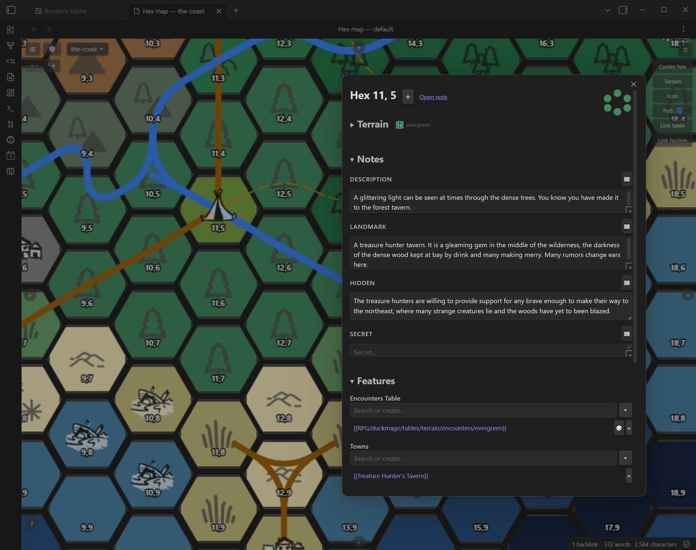

# Hexmap World Creator

A hexmap maker and hexcrawl toolbox for Obsidian, for any TTRPG. Each map is a note in your vault, and any hex can get its own Markdown note — attach locations, paths, and prose directly to the geography of your world.


---

## What it does

Hexmap World Creator gives you an interactive hex grid that lives inside Obsidian. Paint terrain, draw roads and rivers, link town and dungeon notes to individual hexes, overlay faction and geographic region fills, drill into submaps, roll random encounters, and browse everything in a spreadsheet view — all without leaving your vault. Your map and every hex note are plain Markdown files you own.

### Hex editor

Click any hex to open the editor: set terrain, override the icon, link Towns, Dungeons, Features, Quests, Factions, and Encounters Tables, and write freeform notes (Description, Landmark, Hidden, Secret, plus Weather and Hooks & Rumors). Roll a table from the editor and **Add to this hex** puts the result in the section you pick. Link a submap to the hex and click the center dot in the hex flower to dive into it. There is no Save button: the editor saves a moment after you stop typing ("Saving shortly…", then "✓ All changes saved"), and closing it saves straight away. On space maps (a palette with space terrain types, or a map under one) the link sections show as **Settlements**, **Sites**, **Points of Interest** and **Missions** in the editor, the hex table, the badge legend and exports; the note keeps its usual headings. The words come from the map type, so another map type could bring its own.



### Terrain painting

Switch to the Terrain tool, pick a colour from your palette, and drag across hexes to paint. Choose a 1×, 3×, or 7× brush for broad strokes. An eyedropper lets you sample an existing hex's terrain as your active brush.


### Path drawing

Click the Path button to open the path picker. Select any defined path type — road, river, or anything you've created — then click hexes to lay down a chain, or turn on **Auto-route** and click a start and an end to let the path find its own way around impassable terrain. Each type has its own colour, width, line style (solid / dashed / dotted), and routing mode (through hex centres, meandering between them, or tracing hex edges). Edit types at any time from the map toolbar.


### Random tables

A two-panel view for rolling and managing weighted random tables. The left panel shows your tables folder as a collapsible folder tree — the same structure as your vault. Click any table to load it, hit Roll to highlight a result, and see percentage odds for every entry. Create new table files from the toolbar, edit entries inline, and chain tables together into multi-step **workflows** that fill a template note with rolled results.


### Hex table view

A scrollable spreadsheet of every hex note — one row per hex, columns for terrain, description, towns, dungeons, features, quests, factions, encounters table, and all the freeform sections. Click any cell to edit it in place. Filter by map, terrain type, or the presence of specific link types. The ◎ button jumps the map view to that hex's position.


### Faction and region overlays

Paint translucent colour fills over hexes to show political control or geographic regions. Adjacent hexes of the same faction or region merge into smooth blobs with a rendered legend. Toggle overlays from the map overlay panel; overlay state is saved per map.

### GM layer

Toggle the GM layer from the overlay panel to switch between player-facing and GM views. When active, Hidden and Secret sections in the hex editor expand automatically, and hexes with hidden or secret content are highlighted on the map.

---

## Manual Installation

1. Download `main.js`, `manifest.json`, and `styles.css` from the [latest release](https://github.com/sbuffkin/hexmaker/releases/latest).
2. In your vault, create the folder `.obsidian/plugins/hexmaker/`.
3. Copy the three downloaded files into that folder.
4. In Obsidian, open **Settings → Community plugins**, find **Hexmap World Creator** in the list, and enable it.

---

## Getting started

After enabling the plugin, a **setup wizard** opens. It asks what you'll map (a fantasy world, space, or both), where your world folder lives, and makes your first map. What it installs follows that choice: a world setup gets the Expanded and Limited palettes and the biome notes; a space-only setup gets the three space palettes (Sector, System, Planet) and nothing fantasy, and **Palette for new maps** starts on Space - Sector; both gets both. Turning a map type on later in **Settings → Map types** installs its content then (once: anything you delete stays deleted). That last step can **generate the terrain** for you (Overland for a world map, Star scatter for a star sector), with a preview and a re-roll button, or start blank for painting by hand. It also creates the terrain description and encounter tables. That's all you need to start.

To set things up by hand instead (or later):

### 1. Set your world folder
Open **Settings → Hexmap World Creator** and enter a root folder name in **World folder** (e.g. `RPG/world`). This is the base for all other folders.

### 2. Generate folders
Click **Generate folders**. This fills in the hex, towns, dungeons, tables, and other folder settings with sensible defaults under your world folder and creates them in your vault. Any field you've already filled in is left untouched.

### 3. Open the Hex Map
Click the map icon in the left ribbon (or use the command palette: **Hexmap World Creator: Open hex map**). You'll be prompted to create your first map — give it a name, choose its size, and pick a terrain palette.

### 4. Generate terrain tables
Once your folders are set, go back to **Settings → Hexmap World Creator** and click **Generate terrain tables & hex links**. This creates a description and encounters table file for every terrain type and links them into any existing hex notes. It's safe to run again at any time.

You're ready to start mapping.

---

## Features

### Hex Map view
An interactive hex grid rendered as an Obsidian panel.

- **Left-click** a hex to open the hex editor.
- **Right-click** a hex for its menu: its region and locations first (**Enter region: …**, **Open: …**), then centre on it, open its note, **New map from this hex…** (**Add another map…** once the hex has one), link an existing map, link a table, swap hexes, create a token here, clear terrain. Right-clicking a token that covers a hex gives the token's items and then the hex's, under **This hex: …**.
- **Pan** by clicking and dragging with the left or middle mouse button.
- **Zoom** with the scroll wheel.
- **Expand** the grid with the `+`/`−` buttons at the map edges.
- **Go to hex** (`⌖` button in the toolbar) — enter coordinates to centre the view on a specific hex.
- **Undo / Redo** (`↩` / `↪` buttons, Ctrl/Cmd+Z) — step back or forward through this map's changes made in its current work mode (one queue per map per mode; see **Work modes** below).

### Maps
Organise your world into multiple named hex maps, each stored as a subfolder under your hex folder. The active map name is shown in the top-left of the toolbar as a dropdown button.

- **Switch** — click the map name button to open the maps panel, then click any map in the list to make it active. The list is a tree: submaps sit under the map they came from, and neighbouring regions are grouped together. Click ▸ / ▾ to fold a branch; with more than 10 maps a search box finds a map by name.
- **Create** — enter a name, choose a grid size and terrain palette, then click Create. The map keeps the name as you typed it ("Barony of Saltmere"); its folder and map note use a lower-case, dashed version (`barony-of-saltmere`).
- **Name** — change the name shown everywhere. Nothing moves on disk. The name is stored as `display-name:` in the map note.
- **Folder name** — rename the folder itself; its hex notes and map note move with it and links to the map are updated.
- **Delete** — removes the map and moves all its hex notes to the trash.
- **Missing maps** — if a map's folder and map note are deleted by hand (outside the plugin), the map is not quietly re-created empty. It shows in the list with a ⚠ and two buttons, and opening it shows the same: **Restore** writes its map note back from the last saved copy (the plugin keeps one in its folder, `map-cache/`, every time it saves a map note), so its hexes, paths and settings come back exactly; **Remove** drops it from the list (no files are deleted). A note put back by hand (or by sync) loads again on its own.
- **Weather and rumours** — the tables the hex editor rolls for Weather and Hooks & Rumors on this map (stored in the map note as `weather-table` and `rumors-table`).
- **Terrain theme** — assign a terrain type to a map. The swatch appears next to the map name in the switch list and sets the colour of the submap center dot when this map is linked as a submap from a parent map.
- **Back** (`← Back` button) — returns to the previously active map after following a submap link.

### Generators
Maps can be generated instead of painted hex by hex. When you create a map (**Maps → New map…**, or the setup wizard's first map) or a submap (right-click a hex → **New map from this hex…**), pick a generator and preview it before creating. A new map starts on Overland (Star scatter for space-only setups); pick Blank to paint it all yourself. **More** under the form sets the starting coordinates, stagger and a background image (picked from the vault or dropped from your computer), and the **folder name** (made from the name; you can change it later in Map properties). A new submap is named after its hex, or its terrain and coordinates ("Barren world 12, 5") if the hex has no name, with " (2)" added if another map already has that name; click the name once to select it all and type your own. A palette a new map installs, and generated paths with no matching path type on the new map's palette (an orbit crossing a planet), are handled quietly, with no notice.

- **World biomes** (Advanced) — an overworld: one biome per hex, laid out by temperature, moisture and height, with transition biomes (taiga between tundra and forest, savanna between jungle and badlands) where two shouldn't touch. Its hexes open into regions that blend with each other.
- **Overland** — a region from noise: seas, coasts, plains, forests, hills, mountains. Set water %, climate, and which side the sea is on.
- **Region detail** (submaps) — zooms into the parent hex: its terrain fills the map and each neighbouring hex shapes the matching edge, with that neighbour's own terrain (evergreen next to evergreen) along it; a land neighbour always shows as at least a small strip or corner patch on its side (a swamp to the south-west, say).
- **Star scatter**, **Orbits**, **Planet surface** (space maps) — a star sector, a star system around its star, and a planet's surface. They place terrain by type only: Orbits puts the star-type terrain in the middle, world / gas giant / asteroid belt types on the rings, moon-type terrain beside planets (a system with a planet always has at least one; the map draws a faint dashed tether from each moon to the world or gas giant beside it, hidden with the paths; the PNG export draws it too when it includes paths), a starport and station beside the main world, and a jump point and comet past the last orbit; the Star choice lists your palette's own stars. Space palettes made before these types existed are retyped once on load ("moon" typed world becomes moon, "jump limit" typed void becomes jump limit, and so on).
- **World types** (Advanced: Terrain generators) — which worlds the space generators place and how often, and what each world's own map is made with, as an editable table note in `{world folder}/world-types` (**Default space** ships, with the odds Star scatter and Orbits have always used; **Restore default** puts them back). Each row is a world (a terrain of your palette) with a **Weight** and optional limits: **Map** (sector for Star scatter's systems, system for Orbits), **Orbit** (inner, habitable, outer, or rings like `2–4`), **Stars** and **Temperature**. A row can also say how that world's map is made: **Size** (`20×14`, or a range like `16–24 × 10–14` rolled per world), **Generator**, **Options** (`water=85, climate=lush`), **Palette** and **Base** terrain. The same world can have several rows, so an ocean planet can be likelier and bigger around a yellow star. Edit it as text, or with **Edit world types…** (in the Star scatter and Orbits options, or the command): add, remove and reorder rows, and a preview rolls the table for a map, orbit, star and temperature and shows how often each world comes up next to its odds. The same note has two more tables, each under its own heading: **Stars** (which star Orbits puts in the middle when its Star choice is Random, with a **Weight** each; red dwarfs are the most common) and **Sector features** (Star scatter's special hexes, each with a **Chance** per star system hex such as `1 in 50`, `2%` or `never`; Default space has a deep-space station 1 in 50, an anomaly 1 in 75 and a black hole 1 in 150, the 4% Star scatter has always used). The editor has a tab for each table, each with its own preview. Notes made before these tables existed get the shipped ones added once. Rows that can't be read are reported and left in the note as written. Changes in the editor save automatically, like the hex editor (there is no Save button): a moment after you stop typing, and when you close it. A row that isn't finished yet (no world, or a value it can't read) is marked incomplete and isn't saved; it stays in the editor until you fix or remove it, and is dropped when you close it. Edits you make to the note by hand while the editor is open are kept. Editing needs Build or God.
- **Biomes and presets** (Advanced) — Grassland, Temperate forest, Taiga, Tundra, Alpine, Badlands, Savanna, Jungle, Swamp, Karst, River delta, Coastal fjord, Archipelago, Deep forest, Valley and Volcanic. They place terrain by terrain *type*, so they work with Limited, Expanded, or your own palette (as long as its terrains have types). On Limited, terrain kinds it lacks fold into the nearest one (marsh becomes grass, peaks become mountain). Streams and trails are drawn as your River and Road path types if you have no stream or trail type.
- **Learned generators** — made in the **Terrain generator** view (command palette: **Hexmap World Creator: Open terrain generator**) by learning from maps you've already painted, or by blending several.

**Regions and locations.** A hex can open into maps of its own: any number of **locations** (a town, a dungeon, a ship: each with its own size and palette) and, with the Advanced *Regions and overworlds* feature, one **region** (the hex itself, up close). Right-click a hex → **New map from this hex…** and pick Region or Location; a short line under each says which is which (on space maps: a star system, planet or station is a Location). If the hex already has maps, the dialog lists them first with an **Open** button each, and the menu item reads **Add another map…**. Inside a submap, the breadcrumb ends with what its hex was on the parent map ("from: barren world"). The first region of a map asks once for its **region settings**: hex flower (7, 19, 37, 61 or 91 hexes) or rectangle (6×6, 8×8, 10×10 or custom), palette and blend width. Every region of that map uses them, so they line up; they are fixed once a region exists (the map menu's **Regions** tab shows them, with the list of regions; blend stays editable). The right-click menu shows the region and up to two locations by name; from three on, **Locations (n)…** opens a list to search, open, unlink and reorder. Every submap made before this is a location; nothing about it changes.

**Rectangle regions join up.** Rectangles are laid like bricks: each region sits in its own slot of one grid shared with the regions around it, so walking off a region's edge (or clicking the dimmed hexes past it) lands in the next region at the right hex, and a small hex flower on the toolbar shows all six neighbours in their directions (hover a petal for its name, click to go there). An empty petal shows **+** ("New region to the north-east"): click it to walk into new land. Pick the biome that lies there, or **Roll** for one (the seed is shown, so a roll can be repeated; **Re-roll terrain** keeps the biome and tries a new seed), check the live preview of the new region blended with every region around it, and **Create and go**. A biome different from yours makes border country between the two. If that hex is past the overworld's edge, the overworld grows by a hex to fit it. The hex editor's neighbour flower offers the same walk on the hexes past a region's edge. Making a region needs Build or God; in Play the **+** is greyed out and says "Switch to Build to make a region." A new region is made from a short form: biome (the hex's terrain is its biome), blend, how wiggly the borders are, and a seed, with a live preview of the region against its neighbours. It blends with the overworld around it, and the hexes along its edges are pinned to the regions already made, so seams line up whatever order you make them in. If the parent hex has no terrain yet, it gets the region's main terrain (painted hexes are never changed). Hex flowers can be set up but don't join their neighbours yet.

**Overworlds.** **Maps → New overworld…** (or the command **Hexmap World Creator: New overworld…**) makes a map of biomes with the **World biomes** generator: rectangle or hex-shaped, a climate, water, land and which way is colder, previewed as a small map of biomes with transition hexes outlined in white and the river in blue. Pick the region size, and tick **Make every region now** to have them all made at once (the **Regions** tab's **Make the missing regions…** does the same later, with progress and a Stop button). On an overworld, the switch at the bottom right picks the view:

- **Regions** (the full view): every region's own hexes, drawn small and stitched together, with blank bricks (just an outline) where there's no region yet; the overworld's own hexes and coordinates aren't drawn in this view. Hover for the region's name; click to go into that region at the spot you clicked. The terrain tool paints the regions' hexes directly, across seams, so a river valley or a road corridor through several regions is one stroke; undo takes it all back. Each hex is written to its region as you draw, so the overworld and any open view of those regions update during the stroke. The terrain tool only works in this view (the Biomes view shows biomes only); where there's no region yet the brush does nothing ("No region here yet; place a biome first"), and in Play it's locked ("Switch to Build to paint the regions."). In both views, clicking a hex or brick with a region goes into it in every mode; clicking an empty one sets its biome (Build and God). Right-click a region for **Enter region** and **Edit region…**: one window with the region's name (editable), the overworld hex it's on, **Enter region** and **Open map note**, its biome, a few facts (size and shape, palette, terrain counts, neighbouring regions you can click to go to, locations) and its notes. The notes are kept in the region's map note under a plain `## Notes` heading, so you can also edit them there; they're editable in every mode. In God mode the biome is a picker (choosing another remakes the region), with **Reroll** and **Settings…** (biome, blend, seed, live preview); in Build and Play it's shown with "Switch to God to change it." On an empty hex the menu offers **Set biome…** (Build and God). The overworld is the big-picture view, so it has no hex editor: right-click shows only these region-level items, **Center on this hex** and the hex's **Locations**. Painted hexes are locked, so remaking a region keeps them.
- **Roads and rivers on an overworld** are drafts (drawn faded) until you confirm them. Select one with the path tool and click **Confirm into regions** (in the bar at the top, or right-click the path; **Edit region…** lists the paths through that hex with the same button). The path is routed through every region it crosses: neighbouring regions agree on the hex where it crosses their shared edge, so it joins up at every seam, and inside each region it follows that region's own terrain with the path type's routing. Each region gets one path of the same type and name (forks become its branches); its **Overworld path** column in the region's map note says where it came from. Paths you drew in a region yourself are never touched, and a region path you renamed keeps your name. If the type **carves** terrain (River carves water by default; see Path types), the hexes it crosses become that terrain, except locked (hand-painted) hexes. The overworld path's **Applied** column says it's confirmed; reshaping, retyping or renaming it makes it a draft again, and **Update regions** puts the new route in (the old one's carved hexes go back to their generated terrain). **Remove from regions** takes it out again. Regions made or rerolled later get every confirmed path that crosses them. Confirming needs Build or God, and undo takes the whole thing back in one step.
- **Biomes**: one biome per hex, labelled, with transitions outlined (no region outlines: every hex has one; hover a hex for its region's name). The terrain tool is off here. Click a hex to set its biome. On a hex with no region yet that makes the region. On one that has a region it remakes it, which replaces its generated terrain, so that needs the map in **God** mode (below); **Reroll** and **Settings…** (blend, borders, seed, with a preview) are in the same box. Right-click → **Set biome…** works in either view. The switch highlights the view that's showing.

**Work modes: Play, Build, God.** Each map has a mode, shown on the toolbar next to the map button; click it to switch. The map keeps its mode (the `mode:` line in its map note) and opens in it next time; new maps are in **Build**.

- **Play** is for running a game: move, place and remove tokens, open and edit notes, roll tables, link tables and factions to hexes, turn layers on and off. The map itself stays as it is. The drawing panel shows only the tools Play allows, with one line naming the mode for the rest ("Switch to Build to edit the map."); the grid's **+** / **−** buttons are hidden, the hex editor shows "Switch to Build to paint terrain." where the terrain and icon pickers were, the map's properties say "Switch to Build to change the map's properties.", and the right-click menu leaves out what's locked and ends with one such line.
- **Build** adds and edits: paint terrain, icons and region areas, draw paths, link maps to hexes, grow the map, make maps and regions from a hex, change the map's properties, place a biome on an empty overworld hex.
- **God** can do everything, including changing a placed biome (**Reroll**, **Settings…**), swapping hexes, shrinking the grid and deleting the map.

Notes, settings and palettes are never locked. There are no confirm boxes for these: the mode is the safety catch.

**Undo per mode.** Each map has its own undo queue in each mode, kept until you close the vault. Undo (**↩** or Ctrl+Z) and redo take back the last thing done on this map in the mode it's in now: undoing a token move in Play never undoes Build's terrain, and switching back to Build picks its queue up where you left it. If something was changed again in another mode since (a token moved in Build, then again in Play), Build's undo skips it rather than moving it back. Terrain, icons, region areas, paths, tokens, swaps, hex editor edits and biome changes (reroll, swap) are all undoable. The buttons' tooltips name the mode.

Which biome a hex is comes from its terrain's **Type**, never its name: forest-type terrains are temperate forest, wetland swamp, and so on. Where a type has variants, the **last** terrains of that type in the palette stand for them, in this order: forest → taiga, deep forest; grassland → savanna; hills → karst; wetland → river delta. Reorder the palette to choose (on Expanded: evergreen, evergreen heavy, savanna, jungle hills, river delta). A terrain with no type has no biome.

**Your own biomes.** Every biome is a plain note in the biomes folder (default `{world folder}/biomes`, see Settings). The built-in ones are written there once when the plugin starts, so you can edit them like any other note; delete one and it stays deleted. A biome note has a name, a colour, a **Mix** table of terrain *types* with weights (never terrain names, so it works on any palette with types), a **Transitions** table (biomes it shouldn't touch and the biome put between them), and in its frontmatter `blend` (narrow, normal or wide), `land-share` and `min-islands` (for watery biomes) and an optional `generator: [[…]]` link. Rows that can't be read are reported and left as you wrote them; your own text in the note is kept. On an overworld's **Biomes** view, **Biomes…** lists them: **Add biome…** opens a form (pick **Blend (built-in mixing)** or one of your generators, name, colour, type weights, blend, land share, fewest islands, transitions) with a live preview of one region, and **Save** writes the note. **Edit…** opens the same form for an existing biome (built-in ones also have **Restore default**, which backs up the old note first). **Edit generator…** (also in **Edit region…**) opens the biome's generator, or its note for now. Biomes linked to a generator say "available once generator regions land" and blend until then. Your biomes appear in the biome picker and make regions with the blend field straight away. Adding and editing biomes needs Build or God. A region keeps its biome when you rename the biome's note; if you delete the note, the region keeps its terrain and **Edit region…** shows "Unknown biome". Inside a region, click the middle of the hex flower to open **Edit region…** for it; the overworld's right-click menu has **Create token here** to mark the party.

**Terrain weights.** A biome's Mix is by terrain type; an optional **Terrain weights** table (`| Terrain | Weight |`) says how one type's share is split between its terrains, so different forests can go together in different ratios: `Pine forest | 3` and `Oak forest | 1` make three pine hexes for every oak. Terrains not listed count 1, and 0 leaves one out. Names are matched ignoring case; rows that can't be read are reported.

**Make a generator from a region.** Edit a region by hand, then **Edit region… → Make generator…** (or right-click the map in **Maps** → **Make generator from …**). It learns how the region's terrain fits together and asks: **New generator** (a name) or **Overwrite existing**, from a list with the most fitting first: the generator of the region's own biome, then its parent biomes', then generators learned from this region, then related biomes' (neighbours it was blended with, similar biomes), then the rest. Overwriting saves the old generator as a plain note in the plugin folder's `backups/` first, and biomes that use it keep using it. A new generator gets its own biome that starts as a copy of the region's biome: climate, land share, fewest islands, transitions, shore, blend, colour and mix, with `parent:` naming the biome it came from and Terrain weights taken from the region. Edit it like any biome note.
**The Biome painter.** On an overworld the drawing tools have **Biome**: pick a biome in a palette like the terrain painter's, then click or drag over hexes in either view. Each hex gets the biome and its region is made as you go, no window. A hex with no region yet can be painted in Build or God; changing the biome of a hex that has a region needs God and only remakes that region when the biome is different (painting the same biome again does nothing). Regions remade by one stroke are one undo step, in the queue of the mode they were made in; making a region for the first time makes a map and isn't undone. **Edit region…** is still there for names, notes and settings, but setting a biome never needs it.

**The Biome column.** An overworld's map note keeps every hex's biome in the **Hexes** table's **Biome** column, by name (`| 3_2 | | forest | Temperate forest |`), not only the ones a terrain can't tell apart. It's read forgivingly (a biome's name, id or note name, any case); a name that isn't a biome is left as written and that hex goes by its terrain. Overworlds made before this get the column filled once when the plugin starts.

**Blank biomes.** **Custom (blank)** is a shipped biome with `blank: yes`: its regions start empty for you to paint, its overworld hex has no terrain (the Biome column names it), and neighbouring regions don't blend into it. Any biome can be blank (`blank: yes` in its note, or **Regions start blank** in its form); blank biomes are never placed by World biomes or listed in pools. They're offered wherever you pick a biome: the Biome painter, **Set biome…**, **Edit region…**, walking into new land, and **New overworld…**'s **Blank hexes** (that many hexes start blank, land first and spread out).

**Biome climates.** A biome note can say where generated overworlds put it, with optional plain keys: `temperature` (cold, cool, mild, warm, hot, a range like `cold–mild`, or numbers like `0.2–0.5`), `moisture` (dry, moderate, wet, or numbers), `elevation` (`low`, `mid` for hills, `high` for peaks, `sea`, or `mouth` for the river's mouth), `coastal: yes` (only next to the coast), `chance` (like `50%`: the share of fitting hexes it takes) and `rare: yes` (at most one hex in about 20). With any of them set, World biomes can choose the biome like a built-in one; left blank, the biome is only placed by hand. The built-in biomes carry their climates in their notes too (older built-in notes get them added once), so you can see and change why tundra goes north. Where several biomes fit a hex, the rarer and then the narrower one is tried first. The biome form has the same fields in a folded **Climate (optional, for generated overworlds)** section. Values the plugin can't read are reported and ignored.

**Generate overworld (first pass).** **New overworld…** lays out the biomes of a **biome pool**: a plain note in the biome pools folder (default `{world folder}/biome-pools`) with a `Biome | Weight | Notes` table linking biome notes. **All biomes** (every built-in) is written there once. In the form, pick a pool and add or remove biomes (built-in, your own, or ones made by a generator), set a weight (1 as its note says, 0.5 half as often, 2 twice, 0 never), and **Save** or **Save as…** a new pool; the preview updates as you go. Climate, land, which way is colder, water and seed are the World biomes settings. **Biomes without a climate**, at the top of the form next to the name and pool, says what the pool's biomes with no climate do: **Fill gaps only** (default: only where no other biome in the pool fits) or **Never place them** (place them by hand with the Biome painter); the overworld keeps the choice as `no-climate-biomes: fill gaps` or `never`, and regenerating uses it. **Coast** has a climate (coastal lowland, roughly 3 in 10 land hexes by the sea), so it lines generated coasts; existing overworlds only change when regenerated. **Create** makes the map (it remembers its pool as `biome-pool: "[[…]]"`) and every region with its biome; every hex's biome is kept in the overworld's **Biome** column. It's only a first pass: edit, reroll or swap any region afterwards. To redo the whole map, open the map menu → **Regions** → **Generate overworld…** (God only): locked hexes keep their terrain and their regions are left alone, every other region is remade in place (its name, notes and locked hexes stay), and missing regions are made.

A small **minimap** of the overworld (bottom right) shows on the overworld and on each of its regions, with the region you're in outlined; click a hex on it to go there. **Neighbouring maps** (below) and overworlds both stay available: pick per map. A map can have N/E/S/W neighbours and regions at once; a region itself joins its neighbours by itself, so it doesn't offer the neighbour tools.

**Neighbouring maps.** In **Maps → New map…**, **Next to** makes the new map a region beside an existing one (same size and palette, lined up hex for hex); **Properties → New region here…** opens the form already placed. The generators marked *Continues … edge* (Overland and learned generators) carry the neighbour's terrain on across the shared border, and the preview shows the neighbour's edge faded around the new map. Region detail is only offered for submaps, since it zooms into a parent hex.

**Shared coordinates.** Neighbouring regions number their hexes on one grid, so a hex number is unique across the world: the map east of a 20-column map that starts at 0 starts at column 20. The placement note shows the range ("Hexes 20, 0 to 39, 13"). Maps joined before this, or two existing maps linked in **Properties → Neighbouring regions**, keep their own numbers; nothing is renamed. After the map button and the ← ↑ → arrows (back, parent, forward: always in that order, hover for the map each goes to), the neighbouring regions show as a small ◀ ▲ ▼ ▶ pad, one button per side; hover for the name, click to go there. An empty side shows **+** and opens the same walk into new land (pick or roll a biome, preview, create). Inside a submap, the pad goes to its parent's neighbours, one click away. A road or river that ends on a region's edge, next to the end of the neighbour's path of the same type, is drawn on to the shared edge on both maps so they join.

Generators only change hexes when a map is created or regenerated; you can always repaint by hand afterwards.

### Hex editor (click a hex)
A modal for editing a hex note without leaving the map.

- **Name** — give the hex a name ("Glass Wastes"). It shows on the map under the hex's icon, in the hover text and in the hex table, and is stored in the map note, so a hex doesn't need a note to have one. When the hex has a note, the name is also added to the note's `aliases`, so the quick switcher, search and `[[links]]` find the note by name (the file stays `x_y.md`). Renaming swaps that alias; aliases you added yourself are kept. Every hex note also gets its map name and coordinates as an alias ("Gloomwood 3, 4"), so the quick switcher finds a hex by its coordinates; renaming the map updates it.
- **Terrain picker** — select the terrain type for the hex from the map's palette.
- **Icon override** — override the default terrain icon with any icon in your icons folder. Icon pickers have **All / Terrain / Places / Custom** tabs (plus **Space** when space maps are on); **Places** holds 55 settlement, castle, tower, ruin, temple, camp and cave icons (chips narrow it to Settlements, Castles, Towers, Ruins, Temples, Camps or Caves & mines; it is hidden in a space-only setup), and **Custom** holds the images in your icons folder.
- **Maps strip** — the maps this hex opens into: its region (outlined chip) and its locations. Click a chip to go there; **+** makes a new map from the hex, links an existing one, or opens the locations list. The hex flower's center dot enters the region (or the only location), coloured by that map's terrain theme.
- **Towns / Dungeons / Features / Quests / Factions** — link existing notes from their configured folders, or create a new note by name. Linked items are clickable and open in a new tab. Each entry has a remove button.
- **Encounters Table** — link random table files to a hex. Clicking a linked table opens the Random Tables view with that table pre-selected.
- **Notes sections** — Description, Landmark, Hidden, Secret — inline text areas; a 📖 button rolls the section's table where one exists.
- **Weather and Hooks & Rumors** — folded under Notes. 🎲 rolls the map's weather or rumours table (set in **Maps → Properties → Weather and rumours**); ⋯ picks a different table for one hex. With neither set, the starter `weather.md` / `rumors.md` in your tables folder is used.
- **Add to this hex** — any roll made from the editor (encounter tables, section tables) can be added to a section of this hex's note, chosen from a list (the section you rolled from comes first). The note is created if the hex has none. **Copy** is always there too.
- **Run workflow** (Advanced: workflows) — the link beside the hex title picks a workflow and runs it for this hex; **Add to this hex** puts the filled-in result into a section (its headings become bold lines so the section stays whole).
- **Open note** link next to the hex coordinates opens the full note in a new tab.

### Random Tables view
Open via **Command palette → "Hexmap World Creator: Open random tables"** or the 🎲 button in the hex map toolbar.

A two-panel view for managing and rolling on random tables.

- **Left panel** — shows all `.md` files in the configured Tables folder as a collapsible folder tree. Click a folder header to expand or collapse it. Click a table to load it. The filter input at the top narrows results and temporarily expands all folders. **+ New** creates a file from the default template.
- **Right panel** — shows the table's entries with their roll ranges and odds. **Roll** rolls the die, highlights the row and shows the face (e.g. `d20 → 14`) and the result. The result is editable before use. Roll history shows the last 5 results.
- **Change die** dropdown — updates the `dice:` frontmatter and redoes the roll column for the new die.
- **Problems** — if the ranges and weights disagree, or a range can't be read, a banner says so, with one-click fixes (**Keep ranges → set weights**, **Keep weights → redo ranges**).

Table notes are meant to be rolled by hand, too. Each row shows its roll range for the table's die:

```
| d20   | Result  | Weight |
|-------|---------|--------|
| 1–16  | crabmen | 4 |
| 17–20 | mage    | 1 |
| —     | kraken  | 0 |
```

What you see in the roll column is what you get: the plugin rolls the same ranges. A range you type by hand is never overwritten; a blank range cell is filled in from the weights. Weight 0 (`—`) is never rolled. d100 accepts `01–05` and `00`; d66 is supported (`dice: d66`). Columns are found by name (Range/Roll/dN, Result/Entry, Weight/W), and extra columns and text around the table are kept. Older `| Result | Weight |` tables still work; **Add roll ranges to tables** upgrades them (after making a backup), and **Check tables** writes a report of anything that couldn't be read to `_table-check.md` in the tables folder.

### Workflows view
Open via the Workflows tab in the Random Tables panel.

Chain multiple table rolls together into a filled template note.

- **Create a workflow** — define steps (each step rolls a table N times), a template with `$placeholder` variables, and a results folder.
- **Roll a workflow** — each step shows a dropdown and a Roll button. The template fills in live as you roll. Save the result as a new vault note.

### Terrain tables & hex linking
Each terrain type has two auto-generated table files: `{terrain} - description.md` and `{terrain} - encounters.md`, stored under `{tablesFolder}/terrain/`. With only the Space map type on, tables are made for the space palettes' terrains only, not the fantasy ones (unless a map uses that palette). A terrain gets its two tables as soon as it's created, wherever: the terrain tool, the palette editor, a new or copied palette, or a row added to a palette note. They start empty, ready for you to fill. Renaming a terrain renames its tables too (links to them follow).

> ⚠️ **Configure all folder settings before clicking Generate.** The Generate button (Settings → Hexmap World Creator → Generate world data) creates the terrain table files and links each hex note's terrain encounters table into its Encounters Table section. It is safe to run multiple times.

### Drawing tools (toolbar)
Click the **pencil** icon on the right edge of the map to open the drawing tools panel. **Right-click** off a hex (or click the active button again) to exit any tool. Tools that link or paint items show a **Remove** option at the start of the picker — selecting it enters erase mode so you can click hexes to remove that layer.

| Tool | Left-click | Right-click (on hex) |
|------|------------|----------------------|
| **Terrain** | Paint terrain (drag to paint multiple hexes) | — |
| **Icon** | Paint an icon override | — |
| **Path** | Add hex to the active path chain (or, with Auto-route, pick the start and then the end) | Remove hex from chain |
| **Link table** | Add the selected random table to the hex's Encounters Table section | — |
| **Link submap** | Add the selected map to the hex's locations | Remove that map from the hex (any map, if none is selected) |
| **Factions** | Paint a faction colour (drag to paint multiple hexes) | Erase faction from hex |
| **Region areas** | Paint a region note's colour (a geographic area, not a region map) | Erase region from hex |
| **Token** | Open the token creator, then click a hex to place the new token | Cancel placement |

**Terrain painter extras:**
- Clicking the Terrain button always reopens the palette so you can switch colours mid-session.
- **Pick** (eyedropper) — samples the terrain from the next hex you click and sets it as the active brush.
- **Clear** — paints the "no terrain" state.
- **Brush size** — paint 1×, 3×, or 7× hex radius at once.

**Path tool:** Click the Path button to open the path type picker. Select a type to start drawing, or switch to edit mode to create, rename, recolour, or delete path types. Each path type has a name, colour, line width, line style (solid / dashed / dotted), and routing mode:

- **Through** — smooth Bezier curve through hex centres.
- **Meander** — gentle curve through the midpoints between hex centres (good for rivers).
- **Edge** — traces strictly along the hex polygon boundary lines between hexes.

**Editing paths:** there is no separate edit mode. While the path tool is on a type, every path of that type shows its points as handles: drag a point to move it, drag the line to add a point there and move it, right-click a point to delete it (a branch or path left with one point goes too, with a notice; undo brings it back), click an end to carry on from it, and click empty ground to start a new path. Click a line to select that path, and click it again to start a fork. Forks stay attached: moving the point a fork leaves from takes the fork along, deleting it moves the fork to the nearest point left on the line, and if the main line goes its forks become paths of their own (still one undo step). Right-click a line (or Shift+right-click a point) for the path menu: Split here, Delete this fork, Delete path, Rename…, Change type…, Reverse. Paths of other types are left alone while you work: a click on one is a click on the ground, and hovering it names the type to switch to (right-click it for **Switch to** that type). Each drag or delete is one undo step, and editing paths needs Build or God mode. The bar at the top of the map lists these actions.

**Auto-route:** the picker (and the bar at the top of the map while drawing) switches between **Hex by hex** and **Auto-route**: in the picker, choose how to draw (step 1), then the path type (step 2). With Auto-route, click a start hex and then an end hex: the path takes the shortest way inside the map, around impassable terrain, keeping close to the straight line between the two, and then carries on from that end, so you can route leg by leg. Path types whose **Auto-route** option is *winding* (River, by default) wind gently instead of running straight; *direct* ones keep to the line. It's an option on each type, never a matter of its name. A route continues an existing path only when its start is that path's end; starting anywhere else (such as the first hex of another road) makes a new path, and existing paths are never changed. The result is an ordinary path: drag its points to reshape it, right-click a point to remove it, or click an end to extend it.

- **Impassable terrain** — set per terrain in the palette editor (Impassable column) or the terrain editor. Defaults go by terrain *type*, never by name, so they work in any palette, custom ones included: every terrain of a water type (deep water, water, shallows) is impassable unless you untick it. A terrain with no type has no default (an untyped "Black Lake" is passable); give it a type, or use **Guess types from names** in the palette editor. A palette with no impassable terrain says so in the bar. Learned generators' **Connected land** uses the same impassable terrains until you save your own list.
- **Carves terrain** — a path type can also say what an overworld path of that type turns the hexes it crosses into when you confirm it into its regions (**Carves**: a terrain's name, or a terrain type such as `water` for the palette's first water terrain; **Carve width** 0 for the path's own hexes, 1 to take the hexes beside them too). New palettes' River carves `water`; Road carves nothing. It's an option of the type, never of its name. Palettes made before carving existed get it once, on the next load: their River (still the one the plugin wrote, same routing and auto-route) is set to carve `water` if it never had a Carves value. The palette notes are backed up first (`backups/` in the plugin folder), and a value you set or cleared to `none` is never changed. The columns appear in the palette note's Path types table once a type uses them.
- **Per path type** — each path type has **Avoid impassable terrain** and **Auto-route** (direct or winding) in its editor and in the palette note's Path types table. The built-in Road avoids impassable terrain and routes direct; River does neither. Any type can be set either way, whatever it's called. Path types saved by older versions get these filled in once, from how those versions treated them, so no map changes look.
- **Cross impassable** — tick it in the bar to let one route go through anyway. If no route exists the map tells you, and suggests this or changing which terrains are impassable.

**Link table / Link submap:** Clicking either button opens a picker. For tables, the picker shows your tables folder as a collapsible folder tree with a filter input. For submaps, the picker shows a filterable list of your maps with their terrain theme swatches. Once a table or map is selected, click any number of hexes to link it. The hex flashes a ripple animation on each successful link.

### Overlays (faction and region)
Toggled from the **layers** panel on the right edge of the map.

- **Faction overlay** — paint a faction colour on any hex. Adjacent hexes of the same faction merge into smooth filled blobs with a coloured border. A legend lists each active faction. Edit faction names and colours from the overlay panel. Faction data is stored as wiki-links in each hex note's `### Factions` section.
- **Region overlay** — paint a geographic region colour on any hex. Regions render as filled blobs with a scaled label centred on the blob. Region data is stored in the map note (see [Map notes](#map-notes)).
- Both overlays can be shown simultaneously and toggled independently.
- Additional toggles: **Show terrain icons**, **Show icon overrides**, **Show paths**, **Show tokens**, **GM layer**.
- **Labels** group: **Coordinates**, **Hex names** and **Token names** (all on by default). With token names off, a token's name still shows while you hover it. Hex names are always readable: never smaller than about 11px on screen, at any zoom. A long name shrinks and wraps at spaces onto up to three lines to fit inside its hex, clear of its badges and coordinates; when it still doesn't fit at a readable size (zoomed out, or a long name), it spills past the hex instead of being cut (words are never split, nothing is cut off). Their colour follows the terrain (dark text on light terrain such as snow, light text on dark terrain). **Aa** beside the Labels heading sets the hex-name font for this map: Theme / Serif / Sans / Handwritten (common system fonts, nothing bundled), size **S / M / L / XL**, **B**old and **I**talic, and ↺ back to the default. The default for every map is in **Settings → Hex name font**. Saved in the map note (`name-font`, `name-size`, `name-style`); the PNG export uses the same font.
- **Show link badges** (on by default) — a coloured icon badge at a hex's right side for each kind of link in its note: towns, dungeons, features, quests, factions. **S / M / L** beside the toggle sets their size (S by default; S is small and stays inside the hex, M and L sit on the hex's right edge so they stand out). Badges sit above hex names and coordinates, and names make room for them. The legend lists the badge kinds shown on the map. Hovering the hex names the linked notes ("Gullmouth · beach · hex 6, 6 · Town: Gullmouth"). Your hex icon stays as it is. The ▸ next to the toggle picks which kinds show. Saved per map.
- Opening or closing the layers panel (or the drawing tools) never moves the map; the panel may cover a few hexes at the right edge.
- **Show legend** (on by default) — a small terrain legend pinned to the bottom-left of the map view, listing only the terrains used on this map by their full names (only names longer than 18 characters are cut, keeping their start; hover a row for the full name). **S / M / L** sets its size; **–** folds it to a small **Legend** button (click to open it again); **×** hides it. The new-map and generator previews show the same legend. Size and visibility are remembered.

### GM layer
Toggle from the overlay panel. When active:

- Hexes with Hidden or Secret content are visually highlighted.
- The hex editor automatically expands the Hidden and Secret sections when opened.

GM layer state is stored per map and persists across sessions. New maps start with it off; maps made before this keep it on until you turn it off.

### Tokens
Place movable tokens on the map — useful for tracking party position, NPCs, or any note-backed marker. Each token's name shows under it (turn this off with **Labels → Token names** in the layers panel; the name still shows on hover).

**Creating a token:**
1. Click the **Token** button in the drawing tools panel.
2. Fill in the token form: choose a note (existing or new), icon, shape (circle / square / hexagon), fill colour, and border colour. The note list holds what a token stands for: notes in the tokens folder (`{world folder}/tokens`, where new ones go) and the towns, dungeons, features, quests, factions and regions folders. Tables, biomes, palettes, world types, generators and hex notes are never listed, here or in any other note picker; table pickers list the tables folder, the workflow picker the workflows folder, and a blank folder setting means its usual place under the world folder, not the whole vault.
3. Click **Next: place on map**, then click any hex to place the token there.

**Interacting with tokens:**
- **Click** a token to open the hex it stands on, just like clicking the hex.
- **Drag** a token to a different hex to move it. The target hex is highlighted as you drag.
- **Right-click** a token for its menu: **Token info** (the linked note title and hex position, with "Jump to hex" and "Open note"), edit its properties (icon, shape, colours), or remove it from the map. Below those, under **This hex: …**, are the items of the hex it sits on (open its maps, **Open hex note**, create a token here…), so you don't have to aim past the token.

Token state is stored in the linked note's frontmatter (`token`, `token-hex`, `token-map`, `token-icon`, `token-shape`, `token-color`, `token-border`, `token-visible`). `token-map` is a link to the map's note (`"[[_Overworld]]"`), so it follows the map when it's renamed; a plain map name is read too. Tokens follow the map they were placed on and persist with the note.

### Hex table view
Open via **Command palette → "Hexmap World Creator: Open hex table"** or the ⊞ button in the hex map toolbar.

A scrollable reference table of every hex note, with one row per hex and columns for all sections.

- **Coordinates column** — click to open the hex note. A named hex shows its name beside the coordinates.
- **Terrain column** — click to open the terrain picker.
- **Town / Dungeon columns** — click an empty cell to add a link (pick existing or create new); click a populated cell to open the note (or a navigation list for multiple links).
- **Text section columns** (Description, Landmark, etc.) — click any cell (including empty ones) to open an inline editor. Saves directly to the section in the hex note, creating the note and section if they don't exist yet.
- **Resize columns** by dragging the border between column headers.
- **Filter** by map, terrain type, or the presence of specific link types using the toolbar controls.
- **Refresh** button reloads all data from disk.

### Export
Export a map for printing or for your players.

- **Where:** the command **Hexmap World Creator: Export current map…** (any map; it starts on the one open in the hex map view), or the map-name button in the hex map toolbar → **Export** tab. Both show the same form.
- **Formats:** **Export PNG** (an image of the map), **Export PDF with reference table** (the map, then a table per section listing each hex's linked notes and the start of its Description), and **Export hexcrawl manual (PDF)** (a printable gazetteer with legend, encounter tables and keyed hexes).
- **Options:** file name; **On the map**: coordinates, icons, paths, hex names, tokens (with their names), link badges, legend (the terrains used and the badge kinds, beside the map), faction overlay, region overlay; output size. The ticks start from what the map view shows (the overlays start off), and the form remembers your last file name, ticks and size for each map. Labels near the edge are kept inside the image. Roads and rivers are drawn bolder than on screen, scaled to the output size (with paths ticked, moon tethers are drawn too, as on screen), and badges use the map's badge size. **PDF table columns** picks which columns the reference table prints (name, terrain, towns, dungeons, features, quests, factions, encounters, description), so you can cut a handout down to what players should see. **Hexcrawl manual** holds the player-version switch and lets you leave out the legend, encounter tables, factions and regions, or index. The form lists the exact file names it will write; files go to the export folder and open in a tab. Exporting again under the same name replaces the file (the notice says "Replaced …") and refreshes the tab already showing it.
- **What players see:** the PNG never includes GM-layer icons, hidden tokens or any note text (Description, Landmark, Hidden, Secret), so it is safe as a handout. The faction and region overlays show their names when ticked; leave them off if those are secret. The PDF's table has no Hidden or Secret text. The hexcrawl manual is the full GM book unless you tick **player version**, which leaves out Hidden and Secret.
- A single note or hex can also be exported: **Hexmap World Creator: Export current note to PDF**, **… to Markdown**, **Export current hex (structured PDF / Markdown)**, or the **Export** link in the hex editor.

### Commands
Every command, as it appears in the command palette:

| Command | What it does |
|---------|--------------|
| **Hexmap World Creator: Open hex map** | Opens the hex map view. |
| **Hexmap World Creator: Open hex table** | Opens the spreadsheet of hex notes. |
| **Hexmap World Creator: Open random tables** | Opens the random tables and workflows view. |
| **Hexmap World Creator: Open terrain generator** | Opens the terrain generator (learn, blend and run generators). |
| **Hexmap World Creator: Open palette editor** | Opens the terrain palette editor. |
| **Hexmap World Creator: Edit world types…** | Opens the world types table editor (which worlds the space generators place, how often, and how each world's map is made), with a preview. Advanced: Terrain generators; space maps on. |
| **Hexmap World Creator: New overworld…** | Generate overworld (first pass): a map of biomes from a biome pool, laid out by climate, whose hexes open into regions that join up; can make every region at once. Advanced: Regions and overworlds. |
| **Hexmap World Creator: Go up to parent map** | From a submap, back to the map it belongs to. |
| **Hexmap World Creator: Go back to previous map** | Returns to the map you were on before. |
| **Hexmap World Creator: Go forward to the next map** | After going back, forward again (like a browser). |
| **Hexmap World Creator: Add map data to this map's hex notes** | Adds a Map data box (terrain, region, name, from the map) under the title of every hex note of the open map, kept up to date when you open a hex. New hex notes from the built-in template already have one. Edits you typed into existing boxes are put on the map first (see Map data in hex notes). |
| **Hexmap World Creator: Update map data in region and faction notes** | Adds or updates a Map data box under the title of every region and faction note: the maps that use it (with hex counts) and, for regions, the encounter table. Kept up to date when you open the note. |
| **Hexmap World Creator: Export current map…** | Opens the map export form (PNG, PDF, hexcrawl manual). |
| **Hexmap World Creator: Export current note to PDF** | Exports the open note as a PDF. |
| **Hexmap World Creator: Export current note to Markdown** | Exports the open note as Markdown. |
| **Hexmap World Creator: Export current hex (structured PDF / Markdown)** | Exports the open hex note with its sections. |
| **Hexmap World Creator: Export current workflow with rolled samples** | Exports the open workflow with example rolls. |
| **Hexmap World Creator: Add roll ranges to tables** | Adds a roll column with die ranges (e.g. `1–6`) to older tables, after a backup. Asks first. |
| **Hexmap World Creator: Check tables** | Writes `_table-check.md` listing tables whose ranges, weights or columns couldn't be read cleanly. |

---

## Settings

Open **Settings → Hexmap World Creator** to configure:

| Setting | Description |
|---------|-------------|
| **World folder** | Root folder for world notes (used by the Features file picker). |
| **Hex folder** | Folder where hex notes are stored, e.g. `RPG/world/hexes`. Each map becomes a subfolder here. |
| **Towns folder** | Scopes the Towns picker to a specific folder. |
| **Dungeons folder** | Scopes the Dungeons picker to a specific folder. |
| **Quests folder** | Scopes the Quests picker to a specific folder. |
| **Factions folder** | Scopes the Factions picker to a specific folder. |
| **Tables folder** | Folder for random table files. Terrain tables are created in a `terrain/` subfolder here. |
| **Workflows folder** | Folder for workflow definition files and their templates. |
| **Templates folder** | One folder for the plugin's note templates, so they're easy to find and edit: `hex.md` (the hex note template, unless **Template path** points elsewhere) and `town.md` (new town notes made from the hex editor or a link picker start from it: a title and Description, People, Places and Rumours headings, to shape as you like). Blank = `templates` in the world folder. Made by **Generate folders** and the setup wizard; `town.md` also appears the first time you create a town. Workflow templates stay beside their workflows. |
| **Default die** | Die size used when creating new table files (d4–d100). |
| **Icons folder** | Folder containing `.png` icon files available as custom terrain/hex icons. |
| **Template path** | Path to a custom hex note template. Supports `{{x}}`, `{{y}}`, `{{title}}` and `{{map}}` placeholders. Leave blank to use `hex.md` in the templates folder (or the built-in template if there isn't one). A path you already set is kept. |
| **Hex gap** | Gap between hexes in pixels. |
| **Hex orientation** | `flat` (default) or `pointy` top hex style. |
| **Path types** | Named path types used by the Path drawing tool. Each type has a name, colour, width, line style, and routing mode. Manage them from the Path button on the hex map toolbar. |
| **Palettes folder** | Folder holding one note per terrain palette (default `{world folder}/palettes`). |
| **Biomes folder** | Folder holding one note per overworld biome (default `{world folder}/biomes`). |
| **Biome pools folder** | Folder holding the biome pool notes used by Generate overworld (default `{world folder}/biome-pools`). |
| **World types folder** | Folder holding the world types tables used by the space generators (default `{world folder}/world-types`). |
| **Palette for new maps** | The palette a new map starts on. *First palette* = the first one listed (overland before space). New installs start on Expanded; any palette can be picked, and renaming it keeps the setting. |
| **Add default palettes** | Shown when Expanded or Limited isn't in the list: puts them back. Palettes you delete (in settings, or by deleting a palette note the plugin wrote) stay deleted, with a copy in the plugin folder's `backups/`; an empty palette list stays empty until you add one. A palette whose note isn't there yet for another reason (an upgrade, a new palettes folder, a note sync hasn't delivered) is kept: its note is written, or the palette comes back when the note arrives. |
| **Terrain palettes** | Named palettes of terrain types. Each palette has a name and a list of terrain entries (name, colour, optional icon and icon tint). Palettes are assigned to maps at creation time. Edit palette contents from the terrain tool on the hex map, or as a table in the palette's note — copy a palette note into another vault's palettes folder to share it. **Add palette** offers built-in presets: *Expanded* (the default fantasy overland palette on new installs; installs from before it keep their first palette as the new-map default: coasts, wetlands, forest and mountain kinds; matches the generators) and *Limited* (fewer, simpler terrains; quicker to paint), plus *Space - Sector* (star charts, one hex per parsec; adds Jump route and Trade route path types), *Space - System* (stars, planets, belts, stations) and *Space - Planet* (a planet's surface: seas, plains, regolith, dunes, ice, craters, lava fields, toxic marsh, crystal fields, ruins, colonies; typed for the Planet surface generator, and what planets and moons open on) for sci-fi games such as Traveller. A palette note's `map-kind:` line (`world` or `space`) says which map type it belongs to; without it, a palette with space terrain types counts as space. New-map palette menus list uninstalled presets too, and show the picked palette's terrains as a row of colour swatches (names on hover) under the menu. |
| **Generate** | ⚠️ Configure all folders first. Creates missing terrain table files and links each hex's terrain encounters table into the hex note. |

---

## Map notes

Each map has one **map note** at `{hexFolder}/{map}/_{map}.md` (e.g. `RPG/world/hexes/Overworld/_Overworld.md`). It holds the map's settings in its frontmatter and a table with one row per hex that has map data: name, terrain, icon, GM icons, region, locations, region map (once a hex has one) and locked. Regions, locations and region maps are wikilinks (`[[Basin]]`, `[[_saltmere]], [[_old-mine]]`), so renaming a note in Obsidian updates them; plain names are read too and become links on the next save. Notes written before this (one Submap column, plain names) are converted once, after a backup in the plugin's `backups/` folder. Hexes with only the map's base terrain (or nothing) have no row. Painting updates the table; you can also edit the table by hand and the map follows. Anything you write in the note outside the "Hexes" and "Paths" tables is left alone. A collapsed **How to edit this note** box at the top explains the columns.

Paths are stored by name in two tables. **Paths** has one row per path: *Path* (its name), *Type* (a path type from the palette), *Route* (written by the plugin) and *Notes* (yours). **Path routes** says where each path goes, as the hexes it passes through in order (`0, 8 → 9, 8 → 13, 8`); the map works out the way between them. A path's `main` row is its main line, and every other row of that path is a fork that leaves it at its first hex. The two tables are linked by the path's name, ignoring case and spacing, so to rename a path edit *Path* in both. Coordinates can be written `3, 4`, `3,4`, `3_4` or `(3, 4)`, separated by `→`, `->`, `>` or `;`. A routes row for a path missing from Paths makes that path (with no type until you give it one); a Paths row with no routes is kept as a path with no route yet. Older notes, which listed every hex of every path (`| Type | Hexes |`), are converted once, after a backup: pieces of the same type that touch end to end become one path with forks, one-hex leftovers with no notes are dropped, and each path keeps exactly the hexes it had. A report of what changed is saved next to the backup. An old `Type | Hexes` table pasted into a note is still read.

The plugin also writes a few things for you to read, worked out from the tables and the map's palette. A **Summary** section above the Hexes table shows the palette (as a link), the map's extent (`−7…30 × −8…16 (38×25)`), the base terrain, a terrain legend with hex counts, the regions on the map, its region settings, how many region maps and locations open from its hexes, and any terrain or path type that isn't in the palette (⚠). In **Paths**, the *Route* column shows where each path's main line starts and ends, how many forks it has and how many hexes it covers (`0, 8 → 13, 8 · 2 forks · 31 hexes`), with a ⚠ when its type isn't one of the palette's path types, it has no type yet, or a stretch can't be routed and is drawn straight. These are never read back: they're rewritten on each save, so edits to them are replaced, and a deleted Summary comes back. Text you type under the Summary, or a Summary heading of your own, is left alone. Map notes from before this are given them once, after a backup.

**Map data in hex notes.** A hex note from the built-in template has a **Map data** box under its title: the hex's map and coordinates, terrain, region and name, plus its region map and locations (as links) when it has them, and its biome on an overworld (linked to the biome note). The map note is where these live; the box is a copy, refreshed when you open the hex in the hex editor or open the note. You can edit **Terrain**, **Region** and **Name** in the box: when you leave the note (or open the hex editor, or run *Add map data to this map's hex notes*), the change goes onto the map, as one undo step. It doesn't if the map has changed that value since the box was last written (the map's value is newer), if the map's mode locks it (Play can't paint terrain or regions; names are fine), or if the terrain isn't in the map's palette. Those edits stay in the box as a `Not applied:` line saying why, lines it can't read become `Not read:` lines, and a notice tells you; delete those lines when you're done with them. Change the map, region map, locations and biome on the map itself. The plugin keeps what each box last showed in `map-data-shown.json` in its folder; a note it has no record of (first run, another device) just gets its box refreshed from the map.

Older hex templates had `**Terrain:**` and `**Region:**` lines to fill in by hand. The map is where terrain and region live now, so a filled-in line moves into the Map data box as an `Old terrain:` / `Old region:` line, under the map's own values: your words are kept, and they never change the map. Copy one onto the map by editing the box's Terrain or Region if you want it. This happens once for every hex note when you update (after a backup, see below), and again whenever a note gets such a line (when you leave the note or open the hex editor). Empty lines and template placeholders are left where they are.

Hand edits are forgiving. Each setting is one plain property (the parent map and background image are links, e.g. `parent: "[[_coast]]"` with `parent-hex: 3, 4`), so the Properties panel can edit them too, and deleting a property resets that setting. In the tables, headers can be in any case and any order, you can add your own columns (they're kept), the `| --- |` row is optional, hexes can be written `3_4`, `3, 4` or as a link, and `yes`/`true`/`x`/`✓` all mean yes; the next save tidies the formatting without changing your values. Terrain and palette names in the wrong case are matched to the palette. A row or setting that can't be read is kept exactly as you wrote it and listed in a warning box in the note (and a notice), until you fix it. If the note can't be read at all (say the `---` lines around its properties get broken), the plugin won't write to it and shows a notice until you fix it; your text is never rebuilt over.

Map notes written by earlier builds (with JSON values such as `parent: {"map":…}`) still load; the first start of this version converts them once, after saving a copy in the plugin folder's `backups/`.

Older versions kept terrain and the rest in each hex note's frontmatter. The first time this version starts, it moves that data into map notes, keeps a JSON backup in the plugin folder's `backups/`, and replaces those frontmatter fields with a `map:` link to the map note. Note text is never changed or deleted. Older plugin versions on other devices don't read map notes, so update every device that shares the vault.

## Hex notes

Each hex note lives at `{hexFolder}/{map}/{x}_{y}.md` (e.g. `RPG/world/hexes/Overworld/3_7.md`). Hex notes hold descriptions and links, and are created when a hex first gets some (you open it, write in the editor, or link something); painting terrain doesn't create one. Its frontmatter links to the map note:

```yaml
---
map: "[[_Overworld]]"
---
```

Older notes say `hexmaker-map: "[[_Overworld]]"` (map notes use `hexmaker-map:` for their format number). Both are read. A note that already uses `map:` for something of its own keeps it, and its link stays under `hexmaker-map:`.

**Note format changes.** The first start after updating rewrites older notes once, so links survive renames:

| What | Before | After |
|---|---|---|
| Hex notes: link to the map note | `hexmaker-map: "[[_coast]]"` | `map: "[[_coast]]"` |
| Hex notes: hand-filled terrain / region lines | `**Terrain:** forest` in the text | `> Old terrain: forest` in the Map data box |
| Token notes: the map a token is on | `token-map: coast` | `token-map: "[[_coast]]"` |
| Second tokens for a note: the note they stand for | `token-link: world/npcs/Ana.md` | `token-link: "[[world/npcs/Ana]]"` |
| Workflows: their template | `template-file: world/workflows/templates/npc.md` | `template-file: "[[world/workflows/templates/npc]]"` |

Before changing anything, the full text of every note it changes is saved in the plugin folder's `backups/note-formats-<date>/` (one gzipped file per change). Each change runs once per vault (recorded in `data.json`); a vault with nothing to change has no note written. The old forms are still read, so notes from another device on an older version keep working. Notes skipped on purpose (a `map:` key of your own, a link to a note that doesn't exist) are listed in a notice.

**Sections** (used by the editor and table view):

| Heading | Type | Purpose |
|---------|------|---------|
| `### description` | Text | What the party sees and feels |
| `### landmark` | Text | The standout visible feature |
| `### Towns` | Links | Settlement links |
| `### Dungeons` | Links | Dungeon/site links |
| `### Features` | Links | Other points of interest |
| `### Quests` | Links | Active quest links |
| `### Factions` | Links | Faction links (used by the faction overlay) |
| `### Encounters Table` | Links | Random table links (linked to terrain by Generate) |
| `### hidden` | Text | Discoverable with effort |
| `### secret` | Text | Revealed only through investigation |
| `### weather` | Text | Weather notes |
| `### hooks & rumors` | Text | Adventure seeds |
| `### Weather Table` | Link | Optional: this hex's own weather table (instead of the map's) |
| `### Rumors Table` | Link | Optional: this hex's own rumours table |

You can use your own template (configured in Settings). Any `### Heading` that matches a section name will be picked up automatically.

---

## Development

```bash
npm install        # install dependencies
npm run dev        # watch mode — rebuilds main.js on every save
npm run build      # production build (type-check + bundle)
npm run version    # bump version (updates manifest.json and versions.json)
npm test           # run the test suite
npm run test:integration  # integration tests
npm run smoke      # smoke vault matrix in sandboxed Obsidian (Windows; see below)
npm run premerge   # build + lint + tests + integration + smoke: run before merging or deploying
```

**Before merging into the integration branch or deploying a build into a real vault, run `npm run premerge`** and wait for `PREMERGE PASSED`. The smoke matrix (`dev/smoke/run.mjs`) starts a throwaway, separately profiled Obsidian per vault setup (fresh install, an old 1.5.5 vault, space only, an overworld with regions, neighbour maps, a custom palette, a vault with its folders deleted, 80 maps, Simple level…), up to 4 at once (fewer when free memory is low or the CPU is busy; `--jobs N` sets it), and checks the plugin loads without errors, every map opens, untouched notes stay byte-identical, a restart rewrites nothing, paint and undo round-trip, and Play mode refuses edits. It needs Windows Obsidian and the fresh-eyes tester's `sandbox.mjs` (set `UX_TOOLS_DIR` if it isn't in the default place); `npm run smoke -- --list` shows the setups and `--only <ids>` runs some of them. Results go to `dev/smoke/last-run.json` (and `last-pass.json` on a full pass). It only counts and stops its own sandboxes' processes, so your Obsidian or another smoke run can start or stop while it runs; a sandbox slow to exit gets about 30 seconds more before the stop counts as failed.

The built output is `main.js` in the repo root. Obsidian loads this file directly from the plugin folder.

**Reload the plugin after a build:**
```js
// Paste in Obsidian developer console (Ctrl+Shift+I)
app.plugins.disablePlugin('hexmaker');
app.plugins.enablePlugin('hexmaker');
```

### Source layout

```
main.ts                               ← re-exports HexmakerPlugin
src/
  HexmakerPlugin.ts                   ← plugin entry point
  HexmakerSettingTab.ts               ← settings UI
  HexmakerModal.ts                    ← base modal class (makeDraggable, shared behaviour)
  types.ts                            ← interfaces and type constants
  constants.ts                        ← runtime constants and defaults
  frontmatter.ts                      ← map data getters/setters (via the map store) + token YAML
  sections.ts                         ← markdown section read/write helpers
  utils.ts                            ← shared utilities
  defaultHexTemplate.md               ← built-in hex note template
  noteTemplates.ts                    ← templates folder paths + built-in town template (PA3)
  hex-map/
    HexMapView.ts                     ← interactive hex grid (ItemView)
    HexSidePanel.ts                   ← collapsible side panels (drawing tools, overlays)
    HexEditorModal.ts                 ← hex editor, opened by clicking a hex (Modal)
    MapModal.ts                       ← map management (switch, create, rename, delete, terrain theme)
    SubmapPickerModal.ts              ← link submap to a hex (picker + create)
    TerrainPickerModal.ts             ← terrain palette picker
    TerrainEntryEditorModal.ts        ← edit a single terrain entry
    IconPickerModal.ts                ← icon override picker
    PathPickerModal.ts                ← path type picker
    PathTypeEditorModal.ts            ← edit a single path type
    FolderTreePickerModal.ts          ← table picker (collapsible folder tree)
    FileLinkSuggestModal.ts           ← file picker scoped to a folder
    PainterContextMenu.ts             ← right-click context menu for painter tools
    TokenModal.ts                     ← create/edit a token (icon, shape, colour)
    TokenInfoModal.ts                 ← token info card (jump to hex, open note)
    MapLinkModal.ts                   ← link an existing note to a hex section
    newMapFields.ts                   ← shared new-map form fields (name, size, palette)
  hex-table/
    HexTableView.ts                   ← hex reference table (ItemView)
    HexCellModal.ts                   ← inline cell editor
    HexTerrainPickerModal.ts          ← terrain picker in table view
  random-tables/
    RandomTableView.ts                ← random tables + workflows panel (ItemView)
    FolderTree.ts                     ← buildTree + renderFolderTree shared utilities
    RandomTableModal.ts               ← inline roll modal
    RandomTableEditorModal.ts         ← edit table entries
    WorkflowEditorModal.ts            ← edit workflow definition
    WorkflowWizardModal.ts            ← execute a workflow
    randomTable.ts                    ← parse/roll/odds utilities
    workflow.ts                       ← workflow parse/serialize utilities
```

### Troubleshooting

- **"Failed to load plugin"** — `main.js` is missing. Run `npm run build`.
- **Viewing logs** — Press `Ctrl+Shift+I` (Windows/Linux) or `Cmd+Option+I` (Mac) to open the developer console.

---

## Third-party libraries

This plugin bundles [MiniSearch](https://github.com/lucaong/minisearch) (© Luca Ongaro, MIT License) for in-memory full-text search.

The Places icon pack (`icons/place-*`) uses icons from [game-icons.net](https://game-icons.net) by Delapouite, Lorc, Caro Asercion, Pepijn Poolman, HeavenlyDog and Quoting (CC BY 3.0). The space icon pack (`icons/space-*`) uses icons from [game-icons.net](https://game-icons.net) by Lorc and Delapouite (CC BY 3.0), [Material Design Icons](https://pictogrammers.com/library/mdi/) (Apache 2.0), [Tabler Icons](https://tabler.io/icons) (MIT), and [Kenney Simple Space](https://kenney.nl/assets/simple-space) (CC0). Full per-icon credits and licence texts are in [`icons/CREDITS.md`](icons/CREDITS.md).
